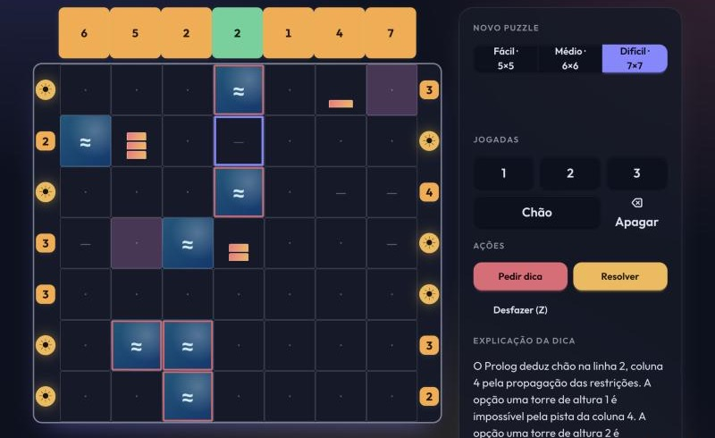

# Ocaso

Ocaso é um jogo de lógica sobre torres e sombras ao entardecer, implementado
com Prolog, Python e Elm. O Prolog modela as regras com CLP(FD), resolve e
gera puzzles de solução única; Python expõe essa lógica por HTTP; Elm mantém o
estado do jogo e calcula as verificações visuais localmente.



## Regras

O tabuleiro é quadrado: 5×5 (fácil), 6×6 (médio) ou 7×7 (difícil). Cada casa
é um lago ou terreno. Um terreno pode ficar vazio ou receber uma torre de
altura 1, 2 ou 3.

- Cada linha tem o Sol a oeste ou a leste. Uma torre sombreia as próximas
  casas na direção oposta ao Sol, até sua altura ou até a borda.
- Nenhuma torre pode ficar na sombra de outra.
- Todo lago precisa ficar na sombra; lagos não recebem torres.
- A pista no fim de cada linha é a quantidade de casas sombreadas nessa
  linha, incluindo lagos.
- A pista no alto de cada coluna é a soma das alturas das torres nela.
- Casas reveladas são fixas. O puzzle gerado tem solução única.

## Como jogar

- Clique numa casa para alternar entre torre de altura 1, 2, 3 e chão (sem
  torre).
- Teclado: setas movem a seleção, `1`–`3` colocam torre, `0` ou `.` marcam
  chão, `⌫` apaga e `Z` desfaz.
- As pistas mudam de cor conforme a contagem: abaixo, exata ou acima do
  valor pedido. Torres na sombra e lagos ao sol aparecem destacados.
- **Pedir dica**: o Prolog deduz uma casa e explica quais regras excluem os
  outros valores, ou aponta uma casa decidida que está errada.
- **Resolver**: o Prolog preenche o tabuleiro com a solução.

## Arquitetura

```text
Elm (navegador) --HTTP/JSON--> FastAPI (Python) --janus--> SWI-Prolog
```

- **Prolog** (`backend/prolog/ocaso.pl`): regras CLP(FD), relação
  `row_shadows/3`, resolvedor, contador de soluções, gerador e dicas com
  explicações.
- **Python** (`backend/app/`): integração Janus e rotas FastAPI; não contém
  regras do jogo.
- **Elm** (`frontend/src/`): `Ocaso.elm` contém o domínio puro, `Hint.elm`
  modela e explica dicas, `Api.elm` trata HTTP/JSON e `Main.elm` implementa
  a interface e a Arquitetura Elm.
- **Estilos** (`frontend/src/style.css`): temas claro/escuro e aparência do
  tabuleiro, lagos, sombras e torres.

## Requisitos

- SWI-Prolog 9.2 ou mais novo, disponível no `PATH` como `swipl`;
- `uv` e Python 3.11 ou mais novo;
- Node.js 20 ou mais novo e `npm`;
- `make` para usar os atalhos abaixo.

O projeto usa `janus-swi` para executar o SWI-Prolog dentro do backend
Python. Se a instalação do Janus não encontrar o SWI-Prolog, confira
`swipl --version` e o `PATH` antes de sincronizar as dependências.

## Instalação e execução

Na raiz do repositório:

```sh
make install
make dev
```

Abra <http://localhost:5173>. A documentação interativa FastAPI fica em
<http://localhost:8000/docs>.

Também é possível iniciar os processos separadamente:

```sh
# Terminal 1
cd backend
uv sync
uv run fastapi dev app/main.py

# Terminal 2
cd frontend
npm install
npm run dev
```

## Atalhos e testes

```sh
make test          # testes Prolog e da API
make test-prolog   # testes plunit
make test-backend  # testes pytest
```

O frontend pode ser verificado separadamente:

```sh
cd frontend
npx elm-format --yes src/
npx elm make src/Main.elm --output=/dev/null
npm run build
```

Antes de entregar, valide o relatório com `make validar`.

## Testando o Prolog no terminal

Não é preciso subir o sistema inteiro para experimentar a parte lógica:

```text
$ swipl backend/prolog/ocaso.pl
?- example_puzzle(P), print_puzzle(P).
?- example_puzzle(P), solve(P, T), print_solution(P, T).
?- generate(hard, P), print_puzzle(P).
?- example_puzzle(P), hint(P, [], Dica).
```

## API

As coordenadas `row` e `col` são baseadas em zero. Um puzzle tem a forma:

```json
{
  "size": 5,
  "suns": ["west", "west", "east", "east", "west"],
  "rows": [3, 2, 1, 2, 3],
  "cols": [7, 0, 0, 3, 3],
  "lakes": [[0, 1], [3, 2], [3, 3], [4, 3]],
  "givens": [[3, 0, 0], [4, 0, 3], [3, 4, 2], [2, 4, 1], [1, 3, 0]]
}
```

`givens` contém `[linha, coluna, altura]`; altura `0` significa terreno
revelado sem torre.

| Rota | Corpo | Resposta |
|---|---|---|
| `POST /api/generate` | `{"difficulty":"easy"}` | Puzzle no formato acima |
| `POST /api/solve` | Puzzle | `{"towers":[[...], ...]}` |
| `POST /api/hint` | `{"puzzle": Puzzle, "placed":[[linha,coluna,altura], ...]}` | Dica marcada por `kind`: `cell`, `wrong` ou `complete` |

Uma dica `cell` inclui a casa e o valor deduzido, o método (`propagation` ou
`search`) e os valores excluídos com as regras que os impedem. Uma dica
`wrong` aponta uma decisão incompatível com a solução. Respostas sem solução
retornam HTTP 422; dados fora do formato também são rejeitados pela validação
da API.

## Problemas comuns

**`ImportError: libswipl...` ao subir o backend ou rodar os testes.** O
pacote `janus-swi` é compilado contra uma versão específica do SWI-Prolog.
Recompile-o a partir do código-fonte, ignorando o cache:

```sh
cd backend
uv sync --reinstall-package janus-swi --no-binary-package janus-swi --no-cache
```

## Estrutura

```text
backend/
  app/main.py            validação e rotas HTTP
  app/prolog.py          ponte Janus para os predicados da API Prolog
  prolog/ocaso.pl        regras, solver, gerador e dicas
  prolog/test_ocaso.pl   testes plunit
  tests/test_api.py      testes da API
frontend/
  src/Ocaso.elm          tipos e regras puras do domínio
  src/Hint.elm           tipos e textos das dicas
  src/Api.elm            encoders, decoders e requisições HTTP
  src/Main.elm           estado, eventos, teclado e interface
  src/main.js            inicialização e persistência do tema
  src/style.css          temas e estilos do jogo
  vite.config.js         Vite e proxy para a API
docs/captura.jpg         captura de tela
Makefile                 instalação, desenvolvimento, testes e validação
RELATORIO.md             relatório do trabalho
AVALIACAO.md             critérios de avaliação
```
