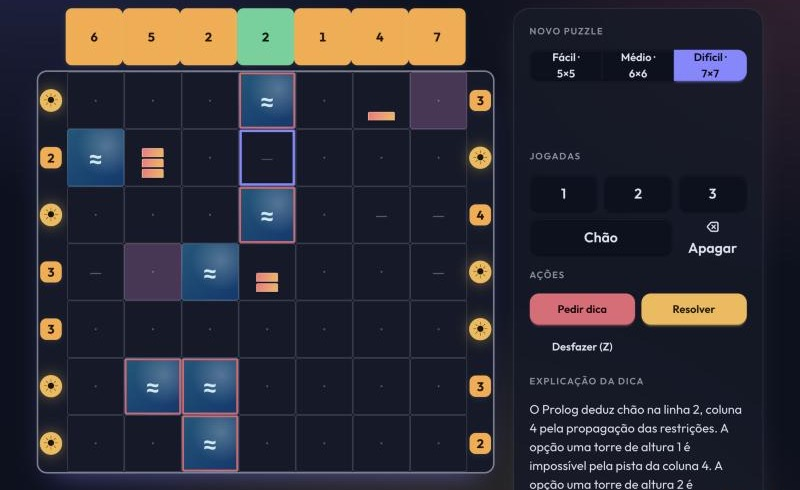

# Ocaso

## 1. Identificação

| Nome completo | Matrícula | Turma 14h | Usuário GitHub |
|---------------|-----------|-----------------|----------------|
| Davi Mesquita | 222006650 | 14h | @davimesquit |
| Anna Clara Brandão | 222006534 | 14h | @annacbrandao |
| Renan Pariz | 222006392 | 14h | @renanpariiz |

- **Nome do projeto:** Ocaso
- **Nome do grupo:** Grupo 5
- **Repositório:** https://github.com/renanpariiz/paradigmas-trabalho-final-grupo5-Ocaso
- **Commit ou tag entregue:** `working-tree`
- **Ponto de partida:** jogo inventado
- **Slides da apresentação oral:** não há

O identificador `working-tree` indica que esta versão ainda não foi commitada.
Deve ser substituído pelo hash do commit de entrega depois da revisão do grupo.

## 2. Resumo

Ocaso é um jogo de lógica sobre torres, lagos e sombras em um tabuleiro de
5×5, 6×6 ou 7×7. O jogador usa as pistas de linhas e colunas para encontrar
as torres. O Prolog modela as restrições, gera puzzles de solução única,
resolve-os e explica dicas; a interface Elm mostra o tabuleiro e acompanha
as jogadas.



## 3. Como executar

**Requisitos:**

- SWI-Prolog 9.2 ou mais novo;
- Python 3.11 ou mais novo e `uv`;
- Node.js 20 ou mais novo e `npm`;
- `make`.

**Instalação e execução:**

```sh
make install
make dev
```

Abra <http://localhost:5173>. A API fica documentada em
<http://localhost:8000/docs>.

**Testes e verificações:**

```sh
make test
cd frontend
npx elm-format --yes src/
npx elm make src/Main.elm --output=/dev/null
npm run build
```

**Testado em:**

- macOS 27 (Apple Silicon), SWI-Prolog 11.0.0, Python 3.15 e Node.js 22.23:
  `make test` passou (22 testes plunit e 12 testes da API, com o Prolog
  real); a formatação Elm, `elm make` e `npm run build` passaram; o jogo foi
  usado no navegador com o backend real.
- Windows, Node.js 22.13 e Python 3.14: a compilação Elm e o build Vite
  passaram; a interface foi exercitada com respostas HTTP simuladas, porque o
  SWI-Prolog não estava instalado nessa máquina.

## 4. Arquitetura

```text
Elm (navegador) --HTTP/JSON--> FastAPI (Python) --janus--> SWI-Prolog
```

| Parte | Responsabilidade | Arquivos principais |
|-------|------------------|---------------------|
| Prolog | Modelar regras, buscar soluções, gerar puzzles e explicar dicas | [`backend/prolog/ocaso.pl:108`](backend/prolog/ocaso.pl) |
| Python | Validar JSON e encaminhar chamadas para Prolog, sem regras do jogo | [`backend/app/prolog.py:16`](backend/app/prolog.py), [`backend/app/main.py:19`](backend/app/main.py) |
| Elm | Domínio puro, textos das dicas, decodificação JSON, estado da aplicação e interface | [`frontend/src/Ocaso.elm:46`](frontend/src/Ocaso.elm), [`frontend/src/Hint.elm:52`](frontend/src/Hint.elm), [`frontend/src/Api.elm:68`](frontend/src/Api.elm), [`frontend/src/Main.elm:76`](frontend/src/Main.elm) |

## 5. Parte em Prolog

### 5.1 Predicados principais

| Predicado | Local | O que faz |
|-----------|-------|-----------|
| `row_shadows(?Sun, ?Heights, ?Shade)` | [`backend/prolog/ocaso.pl:108`](backend/prolog/ocaso.pl) | Relaciona alturas e sombras nos dois sentidos; para sol a leste, inverte a linha. |
| `solve(+Puzzle, -Towers)` | [`backend/prolog/ocaso.pl:242`](backend/prolog/ocaso.pl) | Impõe as regras e procura uma solução. |
| `count_solutions(+Puzzle, +Limit, -Count)` | [`backend/prolog/ocaso.pl:258`](backend/prolog/ocaso.pl) | Conta soluções até um limite, usado para testar unicidade. |
| `generate(+Difficulty, -Puzzle)` | [`backend/prolog/ocaso.pl:288`](backend/prolog/ocaso.pl) | Gera tabuleiro, pistas, lagos e revelações com solução única. |
| `hint(+Puzzle, +Placed, -Hint)` | [`backend/prolog/ocaso.pl:438`](backend/prolog/ocaso.pl) | Deduz uma casa, aponta uma decisão errada ou identifica o puzzle completo. |
| `api_generate/2`, `api_solve/2`, `api_hint/3` | [`backend/prolog/ocaso.pl:541`](backend/prolog/ocaso.pl) | Convertem os dados JSON e os termos internos do jogo. |

### 5.2 Conceitos do paradigma lógico utilizados

- [x] Unificação e casamento de padrões: conversão de puzzles e regras em [`backend/prolog/ocaso.pl:567`](backend/prolog/ocaso.pl).
- [x] Recursão sobre listas: o percurso recursivo da linha em [`backend/prolog/ocaso.pl:125`](backend/prolog/ocaso.pl).
- [x] Backtracking e múltiplas soluções: `solution/3`, `labeling/2` e contagem limitada em [`backend/prolog/ocaso.pl:248`](backend/prolog/ocaso.pl).
- [x] `findall/3`: candidatos a lagos, revelações e valores excluídos em [`backend/prolog/ocaso.pl:348`](backend/prolog/ocaso.pl).
- [x] Corte (`!`) e negação (`\+`): seleção determinística em [`backend/prolog/ocaso.pl:244`](backend/prolog/ocaso.pl) e exclusão de posições fixas em [`backend/prolog/ocaso.pl:396`](backend/prolog/ocaso.pl).
- [x] CLP(FD): variáveis de altura, restrições de sombras e pistas em [`backend/prolog/ocaso.pl:171`](backend/prolog/ocaso.pl).
- [x] Predicados de ordem superior: `maplist/…` em [`backend/prolog/ocaso.pl:172`](backend/prolog/ocaso.pl) e `foldl/…` em [`backend/prolog/ocaso.pl:381`](backend/prolog/ocaso.pl).

### 5.3 Trecho em destaque

```prolog
row_shadows(west, Heights, Shade) :-
    cast(Heights, [], Shade).
row_shadows(east, Heights, Shade) :-
    same_length(Heights, Shade),
    reverse(Heights, ReversedHeights),
    reverse(Shade, ReversedShade),
    cast(ReversedHeights, [], ReversedShade).
```

([`backend/prolog/ocaso.pl:108`](backend/prolog/ocaso.pl))

Esse predicado descreve a relação entre a linha de alturas e sua sombra. No
caso oeste, `cast/3` percorre as casas e restringe a sombra conforme as
torres anteriores. No caso leste, a mesma relação é reutilizada após inverter
a linha. Como alturas e sombras são variáveis CLP(FD), a relação pode tanto
calcular sombras quanto restringir alturas possíveis; não é necessário
escrever dois algoritmos direcionais. O `same_length/2` fixa o tamanho da
sombra antes de invertê-la: sem ele, `reverse/2` sobre uma lista ainda sem
tamanho deixava um ponto de escolha que, no backtracking, nunca terminava.

## 6. Parte em Elm

### 6.1 Modelo e mensagens

```elm
type Source
    = Given
    | Player
    | Prolog

type Cell
    = Lake
    | Undecided
    | Decided Source Content

type Board
    = Board Int (Array Cell)

type alias RowClue =
    { sun : Sun
    , shade : Int
    }

type Pending
    = Idle
    | Generating
    | Solving
    | RequestingHint

type alias Game =
    { puzzle : Puzzle
    , board : Board
    , selected : Maybe Position
    , history : List Board
    , hint : Maybe Hint
    }

type alias Model =
    { game : Maybe Game
    , difficulty : Difficulty
    , pending : Pending
    , darkTheme : Bool
    , error : Maybe String
    }
```

Os tipos do domínio estão em [`frontend/src/Ocaso.elm:46`](frontend/src/Ocaso.elm);
o estado e as mensagens da aplicação ficam em
[`frontend/src/Main.elm:61`](frontend/src/Main.elm). Uma casa distingue lago,
indecisão e conteúdo decidido com origem explícita. `Board` é um tipo opaco
que guarda o próprio tamanho, e o sol e a pista de cada linha ficam juntos em
`RowClue`, em vez de duas listas paralelas. Puzzle, tabuleiro, seleção,
histórico e dica formam um `Game`, e o `Model` guarda `Maybe Game`, então não
existe tabuleiro sem puzzle. A requisição pendente é um tipo próprio, em vez
de uma flag booleana, para representar qual operação está em andamento. O
estado é imutável e o histórico guarda tabuleiros anteriores para desfazer.

### 6.2 Conceitos do paradigma funcional utilizados

- [x] Arquitetura Elm (Model, update, view): [`frontend/src/Main.elm:136`](frontend/src/Main.elm).
- [x] Custom types e `case` exaustivo: [`frontend/src/Ocaso.elm:85`](frontend/src/Ocaso.elm), [`frontend/src/Hint.elm:52`](frontend/src/Hint.elm).
- [x] `Maybe` e `Result` para partida opcional e respostas HTTP: [`frontend/src/Main.elm:85`](frontend/src/Main.elm), [`frontend/src/Api.elm:68`](frontend/src/Api.elm).
- [x] Funções de ordem superior e aplicação parcial: edições como funções `Cell -> Cell` em [`frontend/src/Ocaso.elm:397`](frontend/src/Ocaso.elm) e `edit`/`playing` em [`frontend/src/Main.elm:245`](frontend/src/Main.elm).
- [x] Composição (`|>`, `>>`): cálculo de sombras e pistas em [`frontend/src/Ocaso.elm:312`](frontend/src/Ocaso.elm).
- [x] Decoders e encoders JSON próprios: [`frontend/src/Api.elm:109`](frontend/src/Api.elm), [`frontend/src/Api.elm:223`](frontend/src/Api.elm), [`frontend/src/Api.elm:286`](frontend/src/Api.elm).
- [x] Comandos e subscriptions: requisições HTTP e teclado em [`frontend/src/Main.elm:332`](frontend/src/Main.elm).
- [x] Imutabilidade e atualização de records: transições de estado e desfazer em [`frontend/src/Main.elm:261`](frontend/src/Main.elm).

### 6.3 Trecho em destaque

```elm
    , solved =
        Set.isEmpty towersInShadow
            && Set.isEmpty lakesInSun
            && List.all ((==) Exact) rowStatuses
            && List.all ((==) Exact) colStatuses
```

(trecho de `analyze`, em [`frontend/src/Ocaso.elm:312`](frontend/src/Ocaso.elm))

`Undecided` não representa uma torre e, portanto, não invalida a solução por
si só. O jogo termina quando as torres não estão em sombra, todos os lagos
estão sombreados e as pistas de linhas e colunas são exatas. Como o puzzle
tem solução única, satisfazer todas essas regras basta para reconhecer a
solução sem exigir que cada casa tenha sido clicada. A função `analyze`
calcula sombras, pistas, erros e esse resultado uma única vez a cada desenho
da tela, em vez de cada casa recalcular as sombras do tabuleiro inteiro.

## 7. Integração

As posições da API usam índices iniciados em zero. O puzzle contém tamanho,
orientação do Sol por linha, pistas, lagos e revelações; altura zero em uma
revelação representa chão.

| Rota | Entrada | Saída | Predicado Prolog |
|------|---------|-------|------------------|
| `POST /api/generate` | `{"difficulty":"easy"}` | Puzzle com `size`, `suns`, `rows`, `cols`, `lakes` e `givens` | `api_generate/2` |
| `POST /api/solve` | Puzzle | `{"towers":[...]}` | `api_solve/2` |
| `POST /api/hint` | `{"puzzle":...,"placed":[...]}` | Dica `cell`, `wrong` ou `complete` | `api_hint/3` |

Python valida os formatos com Pydantic e encaminha os dados por Janus. Não
implementa as regras de sombra, restrições ou busca.

## 8. Testes e validação

- O arquivo [`backend/prolog/test_ocaso.pl:42`](backend/prolog/test_ocaso.pl)
  tem 22 testes plunit para sombras, regras, unicidade, geração e dicas,
  todos passando com o SWI-Prolog 11 e sem avisos.
- [`backend/tests/test_api.py:32`](backend/tests/test_api.py) cobre níveis,
  formatos, resolução, dicas, erro e puzzle completo. Os 12 casos passam com
  o Janus e o Prolog reais.
- `npx elm-format --validate src/`, `npx elm make src/Main.elm
  --output=/dev/null` e `npm run build` passaram.
- No navegador, com o backend real, foram exercitados os três tamanhos,
  ciclo de jogada, teclado, desfazer, dica errada, dica deduzida e
  resolução.

## 9. Limitações e problemas conhecidos

- O `janus-swi` é compilado contra a instalação local do SWI-Prolog; em
  algumas máquinas é preciso recompilá-lo (comando no README). No Windows o
  sistema não foi executado com o Prolog real.
- Quando nenhuma regra isolada nem nenhum par de regras explica a dica, a
  explicação diz apenas que o valor é excluído "pela combinação de todas as
  regras".
- Não há suíte automatizada Elm para as funções puras. A compilação e o
  roteiro visual no navegador verificam o cliente, mas não substituem testes
  unitários de cada regra.
- O nível "difícil" é medido pelo tamanho (7×7) e pela quantidade mínima
  de casas reveladas, não pelas técnicas de dedução necessárias.

## 10. Contribuição de cada integrante

A tabela segue o histórico de commits do repositório.

| Integrante | Principais contribuições |
|------------|--------------------------|
| Davi Mesquita | Integração do backend com o Ocaso: rotas e validação Pydantic ([`backend/app/main.py`](backend/app/main.py)), ponte com o Prolog ([`backend/app/prolog.py`](backend/app/prolog.py)) e testes da API ([`backend/tests/test_api.py`](backend/tests/test_api.py)). |
| Anna Clara Brandão | Frontend Elm: domínio do tabuleiro ([`frontend/src/Ocaso.elm`](frontend/src/Ocaso.elm)), tipos e textos das dicas ([`frontend/src/Hint.elm`](frontend/src/Hint.elm)), HTTP e JSON ([`frontend/src/Api.elm`](frontend/src/Api.elm)), interface ([`frontend/src/Main.elm`](frontend/src/Main.elm)), visual ([`frontend/src/style.css`](frontend/src/style.css)) e renomeação do projeto. |
| Renan Pariz | Regras do jogo e parte em Prolog: resolvedor, gerador e dicas ([`backend/prolog/ocaso.pl`](backend/prolog/ocaso.pl)) e testes plunit ([`backend/prolog/test_ocaso.pl`](backend/prolog/test_ocaso.pl)); revisão do frontend; documentação e relatório. |

## 11. Fontes, código de terceiros e uso de IA

**Código reaproveitado.** O repositório partiu da estrutura didática do
template Sudoku para FastAPI, Janus, Elm e Vite. As regras do Ocaso, o
código Prolog, a camada Python e os módulos Elm foram escritos para este
jogo, com uso intensivo de IA (tabela abaixo).

**Referências.** Documentação oficial do SWI-Prolog/CLP(FD), Janus, FastAPI,
Pydantic, Elm e Vite.

**Uso de ferramentas de IA.**

- **Faixa de uso no código:** intensivo

| Ferramenta | Para que foi usada | Como o grupo verificou o resultado |
|------------|--------------------|------------------------------------|
| Claude (Anthropic), via Claude Code | Proposta das regras do jogo, a pedido do grupo; todo o código Prolog (`ocaso.pl`) e os testes plunit; correção de um laço em `row_shadows/3`; refatoração dos módulos Elm (`Game`, `Board` opaco, `RowClue`, `analyze`); revisão do texto das dicas; instalação do ambiente; atualização deste relatório. | 22 testes plunit e 12 testes da API passando com o SWI-Prolog real; compilação e formatação do Elm; jogo testado no navegador; estudo do código pelo grupo para a apresentação. |
| Copilot, assistente de IA | Geração e adaptação da integração Python, da primeira versão dos módulos Elm, da interface e da documentação. | Formatação e compilação Elm, build Vite, testes da API e revisão pelo grupo. |

## 12. Apresentação oral

- **Slides:** não há
- **Roteiro:**

| Parte | Duração | Quem apresenta |
|-------|:-------:|----------------|
| Contexto e objetivo | 2 min | Davi Mesquita |
| Demonstração do jogo | 5 min | Anna Clara Brandão |
| Modelo lógico e dicas Prolog | 3 min | Renan Pariz |
| Tipos e Arquitetura Elm | 3 min | Anna Clara Brandão |
| Limitações e aprendizados | 2 min | Davi Mesquita e Renan Pariz |

## 13. Reflexão sobre os paradigmas

No Prolog, as regras de sombra e as pistas são restrições sobre variáveis,
em vez de passos para preencher a grade em uma ordem fixa. O backtracking e
o CLP(FD) permitem testar unicidade, gerar puzzles e explicar por que uma
altura é impossível usando subconjuntos de regras. A parte delicada é
entender como direção do Sol, índices e propagação se relacionam.

No Elm, custom types separam lago, casa indecisa, conteúdo e origem. Isso
torna explícitos estados que seriam ambíguos em uma grade de inteiros. A
Arquitetura Elm mantém eventos e efeitos HTTP no `update`, enquanto o
cálculo de sombras e o estado das pistas permanecem puros. O grupo precisa
revisar e compreender essas decisões para explicá-las na apresentação.
